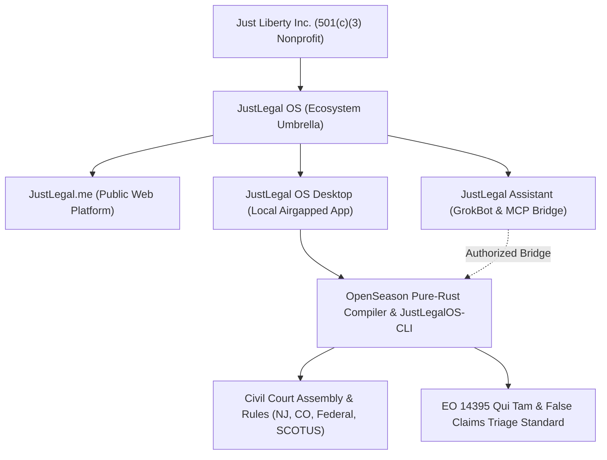

# JustLegal OS: Executive Project Summary & System Architecture

**Organization:** Just Liberty Incorporated, a Colorado 501(c)(3) Nonprofit  
**Platform:** [JustLegal.me](https://justlegal.me/)  
**Desktop Application:** JustLegal OS (`JustLegalOS.exe`)  
**Core Technology:** OpenSeason Native Engine (`open_season_lib` in Rust)  
**Agent CLI & MCP Server:** `JustLegalOS-CLI.exe` (Stdio JSON-RPC 2.0)  
**AI Companion:** JustLegal Assistant (GrokBot Blueprint on x.ai Marketplace)  
**Verification Metrics:** 163 Rust Tests Passing | 0 Svelte Check Errors | 100% Deterministic Airgap  
**Snapshot Date:** October 16, 2026  

---

## Executive Overview

**JustLegal** is a free legal self-help and case-management ecosystem designed to make legal procedures, court resources, and administrative work accessible to ordinary people.

Developed by nonprofit **Just Liberty Incorporated**, the platform combines a national court-forms and legal-resource website, a local-first desktop application, and a growing suite of deterministic command-line tools that autonomous AI assistants can operate on a user's behalf.

The central problem JustLegal addresses is the enormous procedural burden placed on people navigating legal matters without full attorney representation. Courts require accurate forms, properly organized evidence, compliance with strict filing and service rules, rigid statutory deadlines, and specialized procedural knowledge that ordinary people often lack. Missing a deadline or misformatting a verification oath can result in summary dismissal regardless of the merits of a claim.

JustLegal helps users understand and organize legal matters, locate official court resources, preserve evidence with cryptographic provenance, prepare working documents, navigate administrative procedures, and maintain a reliable, verifiable record of what has happened and what needs attention next.

### Professional Independence & Ethical Boundaries (ABA Model Rule 5.4)

* **Not a Law Firm:** JustLegal is not a law firm and does not provide legal representation, practice law, invent facts, or give legal advice.
* **Attorney-First Philosophy:** The platform strongly advocates consultation with licensed attorneys, actively directing users toward state bar association referral services, established legal aid organizations (LSC), and affordable limited-scope representation.
* **Complementary Role:** The goal is to complement professional legal services while giving people practical, free tools to manage the procedural work they must handle themselves.
* **Non-Pro-Se Relator Mandate:** In federal False Claims Act qui tam matters, the system strictly enforces the rule of *U.S. ex rel. Mergent Services v. Flaherty*, directing whistleblowers to experienced contingency counsel rather than attempting pro se relator litigation.

---

## 1. The Three-Part JustLegal Ecosystem



| Component | Platform / Tech | Purpose & Core Capabilities | Development Status |
|---|---|---|---|
| **[JustLegal.me](https://justlegal.me)** | React, TypeScript, Vite, Firebase | **Public Legal Resource Hub:** 22,936 court forms, 16,023 mirrored PDFs, in-browser PDF tools, legal aid directories, fee waiver guides, and optional authenticated case sync. | Existing operational website; UX and deep-linking upgrades active. |
| **JustLegal OS Desktop** | Tauri v2, Svelte 5, Rust (`open_season_lib`) | **Local-First Legal Operating System:** Offline case dossiers, multi-tier matter management, 1-click Bates stamping, court record reconstruction, ADA Title II petitions, and zero-telemetry vault. | Pre-compiled standalone `.exe`, `.msi`, and source builds ready. |
| **JustLegal Assistant / GrokBot** | x.ai GrokBot Blueprint, Local CLI Bridge, MCP | **Conversational Guide & Agent Operator:** Public conversational triage for civil procedure and fraud intake; can request authorized local execution of `JustLegalOS-CLI.exe` on a user's machine. | Architecture, system prompts, skills, and recipes ready in `MCP_Grok/`. |

---

## 2. Existing Website Tools and Resources ([JustLegal.me](https://justlegal.me))

### National Court Forms Registry

The public website maintains one of the most comprehensive structured collections of legal forms in the country:

| Resource | Coverage Metrics |
|---|---|
| **U.S. Court Forms Catalog** | Approximately 22,936 indexed forms |
| **Official PDF Mirrors** | Approximately 16,023 verified files |
| **State-Level Coverage** | All 50 states and Washington, D.C. |
| **Federal Court Coverage** | All 94 federal judicial districts |
| **Integrity Verification** | Retrieval metadata, official source links, and SHA-256 hashes |

### Public In-Browser Tools Already Operational

| Tool | Function |
|---|---|
| **PDF Studio** | Merge, split, and extract PDF pages; apply client-side pagination, electronic signatures, and watermarks. |
| **Bates Stamper** | Sequentially number documents and exhibits for organized production (e.g. `ABRAMS-000001`). |
| **Fee Waiver Generator** | Guide completion of in forma pauperis financial qualification forms across jurisdictions. |
| **Courtroom Script Generator** | Produce structured oral-argument notes, objection cheat-sheets, and rehearsal cards. |
| **Service Hub** | Explain service of process procedures and prepare certificates of service. |
| **Settlement Calculator** | Organize economic/non-economic damages and evaluate structured settlement scenarios. |
| **Guided Case Intake** | Categorize a legal problem into a structured matter and determine procedural posture. |
| **Timeline & Deadlines** | Track court events, orders, appearance dates, and calculate statutory deadlines. |
| **Consultation Summary** | Prepare a concise, objective dossier for an attorney's limited-scope review. |
| **Writing Studio** | Structured complaint, motion, notice of appeal, and petition document builders. |

---

## 3. JustLegal OS — Local Desktop Architecture

The desktop application extends beyond the website by offering a persistent, airgapped workspace for organizing and compiling legal matters without cloud reliance.

### Production Architecture

```
┌────────────────────────────────────────────────────────────────────────┐
│                      JUSTLEGAL OS DESKTOP CLIENT                       │
│                                                                        │
│   ┌───────────────────────────┐      ┌──────────────────────────────┐  │
│   │   Svelte 5 Frontend GUI   │      │   Headless CLI & MCP Server  │  │
│   │   (JustLegalOS.exe)       │      │   (JustLegalOS-CLI.exe)      │  │
│   └─────────────┬─────────────┘      └──────────────┬───────────────┘  │
│                 │                                   │                  │
│                 ▼                                   ▼                  │
│   ┌─────────────────────────────────────────────────────────────────┐  │
│   │             Shared Pure-Rust Legal OS Engine                    │  │
│   │             (open_season_lib — 46+ Rust Modules)                │  │
│   └─────────────────────────────┬───────────────────────────────────┘  │
│                                 │                                      │
│                 ┌───────────────┴───────────────┐                      │
│                 ▼                               ▼                      │
│   ┌───────────────────────────┐   ┌─────────────────────────────────┐  │
│   │ Standard Portable Dossier │   │ Encrypted Confidential Vault    │  │
│   │ Documents/JustLegal/Cases │   │ XChaCha20Poly1305 + Argon2id    │  │
│   │ (case.json, orders, etc.) │   │ (Permanently Airgapped)         │  │
│   └───────────────────────────┘   └─────────────────────────────────┘  │
└────────────────────────────────────────────────────────────────────────┘
```

* **Frontend:** Svelte 5 with fine-grained runes (`$state`, `$derived`, `$props`), TypeScript, and Tailwind CSS running within a Tauri v2 native desktop window.
* **Backend:** 46 modular Rust source files organized into clean domain crates.
* **IPC Surface:** Over 50 Tauri IPC commands paired with browser-preview mock fallbacks (`mockQuitam.ts`, `mockRouter.ts`).
* **Verification:** **163 unit and integration tests passing** (`cargo test`) with 0 errors in `svelte-check`.
* **Zero Monolith Rule:** Strict architectural ceiling enforcing `< 800 lines` per file across both Rust and Svelte.

---

## 4. Shipped CLI Engine (`JustLegalOS-CLI.exe`)

The command-line interface and Model Context Protocol stdio server provide a first-class, headless agent surface. Rather than requiring external AI models to guess procedural steps, JustLegal provides structured, deterministic tools:

```
┌────────────────────────────────────────────────────────────────────────┐
│                   12 SHIPPED CLI TOOL SUBSYSTEMS                       │
├───────────────────────────────────┬────────────────────────────────────┤
│ 1. 360° Case Context Bundle       │ 7. Accountability & Ethics Packets │
│    • `case context` (1-call JSON) │    • `accountability routes|packet`│
├───────────────────────────────────┼────────────────────────────────────┤
│ 2. Guided Intake & PDF Auto-Scan  │ 8. ADA Title II Petition Engine    │
│    • `intake scan` & `answer`     │    • `ada petition`                │
├───────────────────────────────────┼────────────────────────────────────┤
│ 3. Predictive Next Steps & Venue  │ 9. Proof of Service & Orders       │
│    • `case next-steps` & `venue`  │    • `service cert` & `order`      │
├───────────────────────────────────┼────────────────────────────────────┤
│ 4. 30-Day Extension Safeguard     │ 10. Bates Packets & Court Exports  │
│    • `motion new --kind enlarge`  │    • `export exhibit-packet`       │
├───────────────────────────────────┼────────────────────────────────────┤
│ 5. Court Record Reconstruction    │ 11. Zero-Leakage Offline PDF Studio│
│    • `record inventory|reconcile` │    • `pdf merge|split|rotate|redact`│
├───────────────────────────────────┼────────────────────────────────────┤
│ 6. Judicial Findings Audit        │ 12. EO 14395 Qui Tam Fraud Triage  │
│    • `review record`              │    • `qui-tam verify|audit-9b|pack`│
└───────────────────────────────────┴────────────────────────────────────┘
```

### Verified Shipped Command Reference

Every command supports `--json` and emits an envelope contract: `{ ok: bool, never_files: true, never_serves: true, data: ..., issues: [...] }`.

```bash
# 1. 360° Case Context & Onboarding
.\JustLegalOS-CLI.exe --json case context ./my-case

# 2. Guided Intake & Offline Text Ingestion
.\JustLegalOS-CLI.exe --json intake scan ./my-case
.\JustLegalOS-CLI.exe --json intake status ./my-case
.\JustLegalOS-CLI.exe --json intake answer ./my-case --id <question_id> --value "<user_answer>"

# 3. Procedural Next Steps, Tolling & Venue Competence
.\JustLegalOS-CLI.exe --json case next-steps ./my-case
.\JustLegalOS-CLI.exe --json check venue ./my-case
.\JustLegalOS-CLI.exe --json check preflight ./my-case
.\JustLegalOS-CLI.exe --json case escalate ./my-case --target appellate_appeal

# 4. Court Record Reconstruction & Docket Reconciliation
.\JustLegalOS-CLI.exe --json record inventory ./my-case
.\JustLegalOS-CLI.exe --json record reconcile ./my-case --docket "<raw_docket_text>"
.\JustLegalOS-CLI.exe --json record missing ./my-case
.\JustLegalOS-CLI.exe --json record request-form ./my-case --state NJ

# 5. Judicial Review & Ethical Accountability Packets
.\JustLegalOS-CLI.exe --json review record ./my-case
.\JustLegalOS-CLI.exe --json accountability routes ./my-case
.\JustLegalOS-CLI.exe --json accountability packet ./my-case --issue <issue_id>

# 6. ADA Title II Equal Access Accommodation Petitions
.\JustLegalOS-CLI.exe --json ada petition ./my-case --name "Jordan Example" --accommodations "remote,reading_time"

# 7. EO 14395 Qui Tam & False Claims Act Fraud Triage
.\JustLegalOS-CLI.exe --json qui-tam verify-entity --name "Jordan Health LLC" --state MN
.\JustLegalOS-CLI.exe --json qui-tam audit-9b ./my-case
.\JustLegalOS-CLI.exe --json qui-tam ingest-observation ./my-case --file "photo.jpg" --notes "Doors locked at 2 PM"
.\JustLegalOS-CLI.exe --json qui-tam records-pack ./my-case --state MN
.\JustLegalOS-CLI.exe --json qui-tam export-disclosure ./my-case
.\JustLegalOS-CLI.exe --json qui-tam format-portal ./my-case --agency HHS
.\JustLegalOS-CLI.exe --json qui-tam format-inquiry ./my-case

# 8. Document Assembly, Bates Stamping & Service
.\JustLegalOS-CLI.exe --json export exhibit-packet ./my-case --prefix "EX-"
.\JustLegalOS-CLI.exe --json export court-md ./my-case
.\JustLegalOS-CLI.exe --json service cert ./my-case --doc-title "Notice of Appeal"
.\JustLegalOS-CLI.exe --json service order ./my-case --motion-title "Motion to Enlarge Time"

# 9. Offline Zero-Leakage PDF Power Station
.\JustLegalOS-CLI.exe --json pdf merge --inputs file1.pdf,file2.pdf --output merged.pdf
.\JustLegalOS-CLI.exe --json pdf split --input source.pdf --pages "1-5,8"
.\JustLegalOS-CLI.exe --json pdf rotate --input source.pdf --degrees 90
.\JustLegalOS-CLI.exe --json pdf redact --input source.pdf --patterns "SSN,DOB"
```

---

## 5. Forms, Rule Packs & Offline Resources

The system separates official court forms, editable user drafting templates, and informational rule packs into distinct layers:

### The 3-Tier Matter Model

1. **Tier 1 — Transactional Everyday Instruments:** Last Will & Testament with Self-Proving Affidavit, Residential Lease Agreement, Independent Contractor Agreement, Durable Power of Attorney. Requires no court docket or adversary parties.
2. **Tier 2 — Administrative & Pre-Suit Demands:** Commercial Lease Default Notices, Tenant Security Deposit Demands, Statutory Public Records Requests (OPRA, CORA, MGDPA, CPRA, FOIA).
3. **Tier 3 — Court Litigation & Appeals:** Trial-court pleadings (renders `Case No. __________ (To Be Assigned)` for initial filings), Interlocutory and Final Motions, Appellate Briefs, Petitions for Mandamus (Colorado C.A.R. 21), and SCOTUS Petitions for Writ of Certiorari.

### Venue-Specific Procedural Rule Packs

* **New Jersey Appellate Division (`nj-app-div.json`):** Verbatim sworn statement enforcement under **N.J. Ct. R. 1:4-4(b)** rejecting `"to the best of my knowledge"`, tolling calculations under **R. 2:4-3(e)** (`pause_remaining`), and 5¢/7¢ per page fee calculations under NJ Open Public Records Act.
* **Colorado Civil Courts (`co-mandamus.json`):** Distinguishes trial-court conferral rules under **C.R.C.P. 121 § 1-15(8)** from Colorado Appellate Rules (**C.A.R.**), and handles post-trial deadline clock resets under **C.R.C.P. 59** (`reset_full`).
* **Federal Circuit & SCOTUS (`generic-us-appellate.json`):** Unsworn declarations under **28 U.S.C. § 1746**, 3-day mail service rule offsets, and SCOTUS Rule 14.1 Questions Presented.

---

## 6. Confidential Whistleblower Vault & EO 14395 Qui Tam Standard

Built specifically to assist citizen whistleblowers and healthcare relators under **Presidential Executive Order 14395** (*Preserving the Integrity of Federal Programs and Protecting Public Funds*) and the **False Claims Act** (*31 U.S.C. §§ 3729–3733*):

### The 60-Day Statutory Seal Clock (31 U.S.C. § 3730(b)(2))
Federal qui tam complaints must be filed under seal in federal district court with formal service of a confidential Written Disclosure Statement upon the U.S. Attorney General and local U.S. Attorney. The statute establishes an initial 60-day window for DOJ review. JustLegal OS automates the initial 40 hours of investigative verification (NPI entity checks, grant drawdown analysis, physical observation sealing), preventing unnecessary multi-month extensions.

### The Dual-Track Submission Router (Why Two Tracks Are Mandatory)

```
                            Completed & Graded Whistleblower Dossier
                                              │
                      ┌───────────────────────┴───────────────────────┐
                      ▼                                               ▼
       TRACK A: Relator Reward Track                   TRACK B: Citizen Watchdog Track
       (Qui Tam Counsel First)                         (Direct Agency OIG Web Portals)
       ──────────────────────────────────────          ─────────────────────────────────────
       • Potential fraud > $1,000,000                  • Potential fraud < $1,000,000
       • Non-public firsthand insider evidence         • Regulatory non-compliance / localized
       • Preserves 15%–30% relator bounty              • Immediate administrative audit
       • 100% contingency ($0 upfront cost)            • Forfeits statutory relator reward
       • Privileged ABA Model Rule 1.18 package        • Pre-trimmed <2,000 char portal auto-fills
       • In camera court seal strictly protected       • Injects [JUSTLEGAL OS | OPEN-SEASON] Card
```

### Standardized Calling Card Watermark

Every exported disclosure statement, portal auto-fill, and counsel inquiry carries the standardized ASCII diagnostic header:

```
======================================================================
JUSTLEGAL OS | OPEN-SEASON STANDARDIZED FRAUD DISCLOSURE [SCHEMA v1.0 | EO-14395]
Generated via JustLegal.me / Just Liberty Inc. (501c3) Verification Engine
======================================================================
• MATTER CLASSIFICATION: HEALTHCARE_BILLING_DISPATCH_MISMATCH
• TARGET ENTITY: [Verified Legal Name] | NPI: [10-Digit NPI] | UEI: [12-Char UEI]
• REGISTERED TAXONOMY: 251J00000X vs. Observed Status: Empty Facility
• VERIFIED FEDERAL OBLIGATIONS: $3,450,000 (USAspending Confirmed)
• FRCP RULE 9(b) READINESS SCORE: 88/100 (GRADE: A-)
• EVIDENCE MANIFEST HASH (SHA-256): e3b0c44298fc1c149afbf4c8996fb92427ae41e4...
• VERIFICATION SPECIFICATION: https://justlegal.me/openseason-standard
======================================================================
```

---

## 7. JustLegal Assistant — GrokBot Integration (`x.ai`)

The planned **JustLegal Assistant** on the x.ai GrokBot Marketplace serves as a conversational front door:

* **Standalone Web Mode (No Local Install):** Explains court documents, answers procedural questions, guides problem intake, searches official court forms, and provides immediate attorney referrals.
* **Connected Desktop Mode (Authorized Local Execution):** When approved by the user, the bot can invoke `JustLegalOS-CLI.exe` on their local machine to inspect case folders, reconcile dockets, and compile exhibit packets.
* **Airgap Protection:** The local CLI strictly refuses any inspection or cloud command on `.sealed` or confidential folders, ensuring sensitive dossiers remain physically isolated.

---

## 8. Four Desktop User Experience Pillars

JustLegal Desktop organizes procedural complexity around four intuitive human goals:

1. **Understand My Case:** Reconstruct facts, parties, filings, orders, and timeline events from messy court records.
2. **Understand the Rules:** Locate governing statutes, court instructions, mandatory declaration formulas, and statutory deadline clocks.
3. **Figure Out Next Steps:** Identify urgent obligations, missing transcripts, procedural options, and baseline extension lifelines.
4. **Help Me Get It Done:** Format court-compliant pleadings, assemble Bates-stamped exhibit packets, scrub PII, and generate judge-ready proposed orders.

---

## 9. Current Implementation Status & Near-Term Roadmap

| Functional Area | Current Status | Next Strategic Milestone |
|---|---|---|
| **Core Rust Engine** | ✅ **163 Tests Passing; 12 Subsystems Working** | Maintain determinism; expand state rule packs (CA, NY, TX). |
| **Desktop CLI** | ✅ **`JustLegalOS-CLI.exe` Shipped** | Package in automated GitHub release workflow. |
| **Desktop GUI** | ✅ **Functional Svelte 5 / Tauri v2 Client** | Polish 4-pillar dashboard and contextual wizard navigation. |
| **Public Registry** | ✅ **22,936 Forms Cataloged on JustLegal.me** | Expose high-speed search API for instant desktop retrieval. |
| **Qui Tam Triage** | ✅ **EO 14395 Dual-Track Engine Shipped** | Publish public `/openseason-standard` verification page. |
| **GrokBot** | ✅ **Prompts, Recipes & Skills Drafted** | Publish public blueprint on x.ai Marketplace. |
| **Cloud Sync** | ⚠️ **Stubbed & Refused by Design on Sealed** | Implement optional conflict-safe sync for standard cases. |

### Immediate Priority

Deliver one seamless, end-to-end user journey:
*A person receives an adverse court order or administrative notice, opens JustLegal OS, imports the document, automatically reconciles missing hearing transcripts and computes deadline tolling, prepares a 30-day baseline enlargement motion or notice of appeal, Bates-stamps supporting exhibits, and exports a court-ready package—all without a single hallucinated citation or leaked byte of private data.*

---

## Long-Term Vision

JustLegal is building the open, nonprofit infrastructure for access to justice. By combining authoritative legal directories, an offline procedural operating system, and an agent-accessible command-line engine, JustLegal gives ordinary people the tools to manage their legal rights with dignity and procedural accuracy, while keeping licensed legal counsel at the center of the judicial system.
